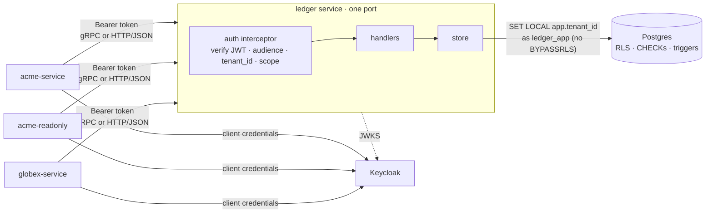

# ledger

[](https://github.com/learnercys/ledger/actions/workflows/ci.yml)

A multi-tenant **double-entry ledger** in Go, served over gRPC and HTTP/JSON
from one port, on Postgres, with OIDC authentication through Keycloak.

The goal is a ledger where the dangerous mistakes are **impossible, not just
unlikely**. Every money rule is checked in Go *and* enforced by Postgres, and
a property-based test hammers the real database with random operation
sequences to prove money is never created, destroyed, duplicated or
overdrawn.

```
$ make demo
==> Alice pays Bob $25.00, and the client retries with the same idempotency key
{"transaction":{"id":"txn_01a1d3ce-61bb-…","description":"Dinner","postings":[
  {"accountId":"acct_…e24","amount":"-2500","currency":"USD","balanceAfter":"7500","accountVersion":"2"},
  {"accountId":"acct_…878f","amount":"2500","currency":"USD","balanceAfter":"2500","accountVersion":"1"}]}}  [HTTP 200]
{"transaction":{"id":"txn_01a1d3ce-61bb-…", …}}                                                              [HTTP 200]
(same transaction ID both times; Bob was paid once)

==> Alice tries to pay $500.00 she doesn't have
{"code":"failed_precondition","message":"insufficient funds: account acct_…e24"}            [HTTP 400]

==> the read-only client can't move money
{"code":"permission_denied","message":"… requires scope \"ledger.write\""}                    [HTTP 403]

==> globex can't see acme's accounts, even with the exact ID
{"code":"not_found","message":"not found"}                                                   [HTTP 404]
```

## Guarantees and where they're enforced

| Guarantee | In Go | In Postgres | Proven by |
|---|---|---|---|
| Every transaction sums to zero per currency | `ledger.CheckBalanced` | deferred constraint trigger, checked at `COMMIT` | `TestDatabaseRejectsUnbalancedTransaction` inserts raw unbalanced postings; the commit fails |
| No overdrafts (unless `allow_negative`) | balance computed under row lock | `CHECK (allow_negative OR balance >= 0)` | 50 concurrent withdrawals of 10 from 100: exactly 10 succeed |
| A retry never posts twice | idempotency key in the same DB transaction | `PRIMARY KEY (tenant_id, key)` | 20 concurrent identical requests: one transaction |
| History is immutable | no update/delete paths | no `UPDATE`/`DELETE` grant + trigger | `TestDatabaseRejectsHistoryEdits` |
| Reversed at most once | advisory lock + check | `UNIQUE (tenant_id, reverses_id)` | 10 concurrent reversals: one succeeds |
| Tenants are isolated | tenant comes from the token | row-level security, fails closed | `TestTenantIsolation`, `TestTenantComesFromToken` |
| Statements have no gaps | version under row lock | `UNIQUE (account_id, account_version)` | property test checks every account after every step |

The reasoning behind each is in [`docs/adr/`](docs/adr):
[database-enforced invariants](docs/adr/0001-database-enforced-invariants.md),
[locking and concurrency](docs/adr/0002-locking-and-concurrency.md),
[row-level security](docs/adr/0003-row-level-security.md),
[idempotency keys](docs/adr/0004-idempotency-keys.md).

## Architecture



- **API:** [`proto/ledger/v1/ledger.proto`](proto/ledger/v1/ledger.proto),
  served with [Connect](https://connectrpc.com). One handler speaks gRPC,
  gRPC-Web and plain HTTP/JSON (`curl` works), with server reflection for
  `grpcurl` and `buf curl`. Code is generated with `buf` (`make generate`)
  and committed.
- **Auth:** OIDC access tokens verified against Keycloak's JWKS. Each token
  must be for audience `ledger-api` and carry a `tenant_id` claim. Writes
  need scope `ledger.write`, reads `ledger.read`. Three demo clients:
  `acme-service` (read/write), `acme-readonly`, and `globex-service` (a
  second tenant).
- **Amounts** are `int64` minor units (cents). No floats anywhere. A posting
  is a signed amount: positive adds to the balance, negative subtracts.
  Debit/credit naming is a presentation concern on top of that.

### API

| RPC | Scope | Notes |
|---|---|---|
| `CreateAccount` | write | `currency`, `allow_negative` (for funding/external accounts) |
| `GetAccount`, `ListAccounts` | read | balance and version included |
| `PostTransaction` | write | 2–100 postings, balanced per currency, `idempotency_key` required |
| `GetTransaction` | read | postings with `balance_after` |
| `ReverseTransaction` | write | posts the exact opposite; at most once; reversals can't be reversed |
| `ListEntries` | read | account statement, newest first, paginated |

## Run it

You need Docker and Go 1.27+.

```bash
make up                 # Postgres, Keycloak, ledger (ports 55433, 58180, 58090)
make demo               # the walkthrough above, with real tokens
make test               # unit tests: domain, auth, API, no Docker
make test-integration   # Postgres: concurrency, RLS, idempotency, property tests
make bench              # spread vs hot-account throughput
make down
```

Calling it yourself:

```bash
TOKEN=$(curl -s -d grant_type=client_credentials -d client_id=acme-service -d client_secret=acme-secret \
  http://localhost:58180/realms/ledger/protocol/openid-connect/token | jq -r .access_token)

# HTTP/JSON
curl -s localhost:58090/ledger.v1.LedgerService/ListAccounts \
  -H "Authorization: Bearer $TOKEN" -H 'Content-Type: application/json' -d '{}'

# gRPC (no .proto needed, thanks to reflection)
grpcurl -plaintext -H "Authorization: Bearer $TOKEN" -d '{}' \
  localhost:58090 ledger.v1.LedgerService/ListAccounts
```

## Tests

| Suite | What it covers |
|---|---|
| Domain unit tests | validation, per-currency balancing, and a property test that a reversal undoes any transaction |
| API + auth tests | real handler and interceptor over HTTP: missing, garbage, expired, wrong-issuer, wrong-audience, tenantless and foreign-key tokens; read-only scope can't write; tenant comes from the token; internal errors don't leak details |
| Integration tests (Postgres, as the unprivileged app role) | concurrent overdraft attempts, concurrent idempotent retries, retry after failure, tenant isolation, cross-currency rejection, reverse-once under concurrency, raw SQL against the DB backstops |
| **Property-based test** ([rapid](https://github.com/flyingmutant/rapid)) | 100 random sequences of opens, transfers, multi-leg postings, idempotent retries and reversals, some invalid on purpose. After every step: balances match an in-memory model, every currency sums to zero, no overdrafts, statements are gap-free. Failures shrink to a minimal sequence. |
| End-to-end (CI) | `make up && make demo` against real Keycloak |

The property and concurrency tests earned their keep. They caught a race
where a second, concurrent reversal reported *insufficient funds* instead of
*already reversed*. The fix (an advisory lock per transaction) is described
in [ADR 2](docs/adr/0002-locking-and-concurrency.md).

## Numbers

`make bench`: `PostTransaction` straight against Postgres, 32 concurrent
writers, 10 s per scenario, Apple M2 Max, Postgres 17 in Docker Desktop,
default durability (`synchronous_commit=on`).

| Traffic | txn/s | p50 | p95 | p99 |
|---|---|---|---|---|
| **spread:** random pairs among 1,000 accounts | 2,365 | 13.1 ms | 17.3 ms | 22.5 ms |
| **hot:** every transfer funded by one account | 720 | 43.9 ms | 49.8 ms | 55.7 ms |

The hot-account drop is the cost of correctness. Every transfer must wait for
that account's row lock to know the true balance. Sharded sub-accounts,
batching, and lock-free updates for allow-negative accounts are the known
ways out, discussed in
[ADR 2](docs/adr/0002-locking-and-concurrency.md#consequences).

## Project layout

```
proto/ledger/v1/     API definition (buf lint: STANDARD)
gen/                 generated Go + Connect code (committed)
cmd/ledger/          the service
cmd/bench/           throughput benchmark
internal/
  ledger/            pure double-entry rules and errors
  store/             Postgres: posting, idempotency, RLS-scoped transactions
  auth/              OIDC verification, tenant and scope checks
  server/            Connect handlers, error mapping, logging
migrations/          schema, constraints, triggers, RLS policies, app role
deploy/keycloak/     realm with demo clients, scopes and tenant claims
docs/adr/            design decisions
```

## What I'd add for production

- **Hot-account sharding**, as above, once a real traffic profile shows the
  need.
- **Retention:** expire idempotency keys after 24h–7d; partition postings by
  month.
- **Holds / two-phase transfers** (authorize, then capture or void) for card
  flows.
- **Migrations tool** (goose / golang-migrate) and a separate owner role for
  migrations.
- **Observability:** OpenTelemetry traces and metrics (lock wait time per
  account is the one to alert on), and audit logs keyed by token subject.
- **Outbox events** (`transaction.posted`) for downstream consumers. My
  [event-pipeline](https://github.com/learnercys/event-pipeline) project
  shows that pattern.
